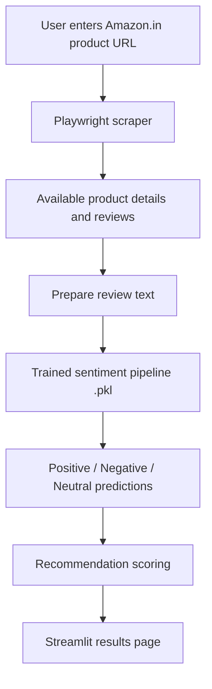

<div align="center">

# 🛒 Amazon Product Purchase Advisor

**An ML-powered tool that analyzes Amazon product reviews and helps users make more informed purchase decisions.**

[](https://www.python.org/)
[](https://streamlit.io/)
[](https://playwright.dev/)
[](https://scikit-learn.org/)
[](#-important-use-notice)

</div>

---

## Overview

Choosing a product online can mean reading hundreds of customer reviews. **Amazon Product Purchase Advisor** is a student project that brings review sentiment analysis and product information together in one place.

Enter an Amazon.in product URL. The application attempts to collect available product details and customer reviews, classifies the review text with a trained machine-learning model, and calculates a recommendation score from the information it can retrieve.

> **The result is an aid to decision-making, not a guarantee of product quality or a substitute for checking the original listing and reviews.**

## How it works



### Main capabilities

- Accepts an Amazon.in product URL.
- Collects available product information and a sample of customer reviews.
- Predicts review sentiment as **Positive**, **Negative**, or **Neutral**.
- Displays sentiment distribution and model prediction confidence.
- Calculates a product recommendation score using available review and product signals.
- Explains the recommendation using the information collected.

Features depend on what the product page makes accessible. The application must report the number of reviews actually collected rather than imply that every review was analyzed.

## Tech stack

| Area | Technology |
|---|---|
| Application language | Python |
| User interface | Streamlit |
| Browser automation / extraction | Playwright |
| Data handling | Pandas |
| Text features and classification | scikit-learn, TF-IDF |
| Model storage | Pickle (`.pkl`) |
| Version control | Git and GitHub |

## Machine-learning approach

The sentiment classifier was trained using the labelled **EMNLP2023-MCD** dataset. The project uses three sentiment classes:

- Positive
- Negative
- Neutral

The model-development experiments included TF-IDF features with unigrams and bigrams, Logistic Regression, and a weighted soft-voting experiment combining Logistic Regression and Random Forest.

The trained `.pkl` pipeline contains the fitted text vectorizer and classifier. The application should load this saved pipeline and use it directly for new reviews; it should not fit a new vectorizer for each product.

### Model evaluation

The recorded experiments achieved approximately:

| Experiment | Accuracy | Macro F1 |
|---|---:|---:|
| Logistic Regression | 82.3% | 0.767 |
| Weighted soft voting | 83.0% | 0.770 |

These are project experiment results, not guaranteed performance on every Amazon category or newly collected review. The evaluation data was used during model experimentation; a separate untouched test set and manually labelled Amazon sample would provide stronger evidence of generalization.

**Prediction confidence is not the same as prediction correctness.** The maximum class probability can be displayed as a model-confidence indicator, but should not be described as a calibrated probability that the prediction is correct unless calibration has been evaluated.

## Recommendation scoring

The initial recommendation design combines multiple signals:

| Signal | Initial weight |
|---|---:|
| Customer sentiment | 30% |
| Product rating | 25% |
| Review quantity | 15% |
| Review reliability | 15% |
| Seller reliability | 10% |
| Price / value | 5% |
| **Total** | **100%** |

The weights and score thresholds are initial design choices and should be validated. The scoring implementation should also:

- Avoid double-counting closely related signals, such as product rating and star distribution.
- Scale or cap review quantity so a very large count does not dominate.
- Treat missing information as unavailable, not as a score of zero.
- Avoid treating a discount alone as proof of good value.
- Indicate when the collected information is insufficient for a useful recommendation.

Possible recommendation labels:

- **Worth Considering**
- **Consider Carefully**
- **Risky Purchase**
- **Not Recommended**
- **Insufficient Information**

## Datasets

This project uses two datasets for different development purposes.

### 1. EMNLP2023-MCD labelled dataset

Used to prepare labelled examples and train/evaluate the sentiment model.

### 2. Historical Amazon review dataset

Approximately **11,462 scraped reviews across 149 products** were used for exploratory analysis, applying the trained model to Amazon review text, examining product-level sentiment distributions, and experimenting with the recommendation logic.

The historical Amazon dataset is **not required by the live URL-based application**. At runtime, the application can scrape available reviews for the URL entered by the user and pass those reviews through the saved model.

The historical Amazon reviews are not ground-truth sentiment labels unless independently labelled and verified. Model-generated predictions must not be used as ground truth when claiming model accuracy.

## Repository layout

The application code is organized into the following main areas:

```text
└── pusalaspreetham-code-amazon-review-analyzer/
    ├── README.md
    ├── amazon_purchase_advisor/
    │   ├── README.md
    │   ├── app.py
    │   ├── login_once.py
    │   ├── requirements.txt
    │   └── advisor/
    │       ├── __init__.py
    │       ├── config.py
    │       ├── data.py
    │       ├── insights.py
    │       ├── pipeline.py
    │       ├── scoring.py
    │       ├── scrap.py
    │       ├── scrape_worker.py
    │       ├── scraper_service.py
    │       ├── sentiment.py
    │       └── ui.py
    ├── data_prepocessing/
    │   └── prepocessing.ipynb
    └── scrapper/
        └── amazon-review-classification/
            └── scrapper/
                ├── links_extraction.py
                └── scrap.py
```

Notebook names and locations should be checked against the current repository. The trained model file and any required supporting files must be placed at the paths configured by the application.

## Getting started

### Prerequisites

- Python 3 installed
- Git
- Internet access
- A supported local browser environment for Playwright

### 1. Clone the repository

```bash
git clone https://github.com/pusalaspreetham-code/amazon-review-analyzer.git
cd amazon-review-analyzer/amazon_purchase_advisor
```

### 2. Create and activate a virtual environment

**Windows PowerShell**

```powershell
python -m venv venv
.\venv\Scripts\Activate.ps1
```

### 3. Install dependencies

```powershell
pip install -r requirements.txt
```

### 4. Install the Playwright browser

```powershell
playwright install chromium
```

### 5. Configure the trained model

Place the trained `.pkl` model at the location expected by the application's configuration. Check the configured path before starting the application.

### 6. Sign in manually when required (optional)

The project includes `login_once.py` to open the persistent Playwright browser profile for a manual sign-in, if the pages being tested require it.

```powershell
python login_once.py
```

Complete any sign-in manually in the browser. When prompted, return to the terminal and press **Enter**. The browser profile may retain the session, subject to Amazon's own session and verification requirements.

**This is not normally required every time the application starts.** Run it only when a manual sign-in is needed or the saved session has expired. The login helper and scraper must use the same browser-profile directory. Do not run two browser processes against the same persistent profile simultaneously.

If the pages you are testing are accessible without signing in, skip this step.

### 7. Run the application

```powershell
streamlit run app.py
```

Open the local URL printed by Streamlit in your browser.

## Important use notice

**This scraper is provided for limited educational and experimental use as part of a student project. It is not intended for large-scale scraping, commercial data collection, or production use.**

Amazon may restrict automated access or display sign-in pages, CAPTCHAs, rate limits, and other access controls. As a result, scraping may fail or return incomplete information.

- Review Amazon's current terms, policies, and applicable laws before accessing, collecting, storing, or sharing website data.
- Prefer official APIs or other authorized data-access methods where available.
- Do not attempt to bypass CAPTCHAs, authentication, rate limits, or other access restrictions.
- Manual sign-in does not override website terms or grant permission to access restricted data.
- Do not share browser profiles, cookies, session files, or login credentials.
- Do not assume that a local browser session will be available in a cloud deployment.
- Stop testing if access is blocked or restricted.

The application should handle scraper errors gracefully and show **Insufficient Information** when it cannot collect enough data for a meaningful recommendation.

## Limitations

- Amazon page structure and access restrictions can change, which may break scraping.
- Some product, seller, price, or review fields may not be available.
- The scraper may collect only a limited sample of reviews.
- Sentiment predictions can be wrong, particularly for sarcasm, mixed opinions, short text, and domain-specific language.
- Model confidence is not proof of correctness.
- Recommendation weights and thresholds require further validation.
- Local browser authentication is not automatically portable to a hosted environment.

## Future improvements

- Evaluate the model on a separate, manually labelled sample of Amazon reviews.
- Calibrate and validate prediction probabilities.
- Validate recommendation weights and score thresholds against test cases.
- Improve handling of mixed sentiment, sarcasm, and short reviews.
- Add automated tests for model loading, scoring, missing values, and scraper failures.
- Explore permitted and more reliable product-data access methods.

## Author

**Preetham**  
GitHub: [@pusalaspreetham-code](https://github.com/pusalaspreetham-code)

---

<div align="center">

**Built as an educational machine-learning project.**

</div>
